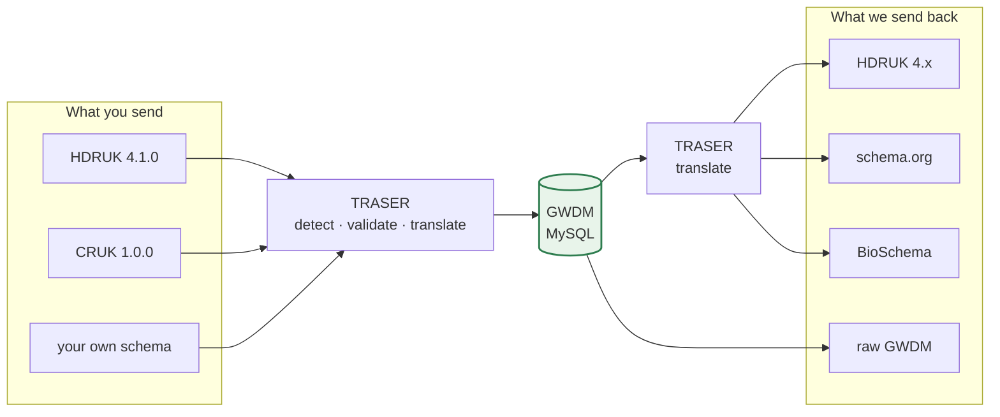

# Key concepts

**Applies to:** HDRUK 4.1.0 · GWDM 2.2

Everything else on this site assumes the ideas on this page. It is worth ten
minutes.

## The one idea that matters

The Gateway accepts metadata in **many input schemas**, translates it into
**one internal model** for storage and search, and can serve it back out in
**many output schemas**. Translation in both directions is done by
[TRASER](../reference/traser-api.md) using [JSONata](../reference/jsonata-cookbook.md) maps.

That internal model is the **GWDM** — the Gateway Working Data Model.

## Three things people conflate

The current documentation runs these together, and almost every support question
comes from mixing them up. They are independent, and they are set independently.

| | What it means | How it is set |
|---|---|---|
| **Input schema** | What *you* send us | Detected from the payload, or stated in the request |
| **GWDM version** | How *we* store it | `x-gwdm-version` header, else the configured default |
| **Output schema** | What we send *back* | `x-schema-model` / `x-schema-version`, else your partner default |

You can send HDRUK 4.1.0, have it stored as GWDM 2.0, and read it back as
schema.org. All three are different schemas, and none of them constrains the
others.

### Input schema

The shape you author your metadata in. The Gateway supports several families —
see [the schema landscape](../schemas/landscape.md). If you are a UK health data
custodian and have a free choice, use **HDRUK 4.1.0**.

You do not have to tell us which schema you are using: TRASER can work it out
from the payload with [`POST /find`](../reference/traser-api.md). Being explicit
is better, though, because detection is ambiguous — a minimal record commonly
matches several versions at once.

### GWDM version

How the Gateway stores your record internally. Selected with the
`x-gwdm-version` request header; without it you get the configured default,
currently `2.0`. Supported values are `2.0`, `2.1` and `2.2`.

This is invisible to most partners and you can usually ignore it. It matters when
a field you care about only exists in a later GWDM version. The versions form a
line — 2.0 → 2.1 → 2.2, each extending the last — but the translation maps do not
all reflect that yet, so see
[how 2.2 relates to 2.1](../schemas/gwdm.md#how-22-relates-to-21).

### Output schema

The shape we translate to when someone reads the record. Resolved in this order,
first match winning:

1. `?schema_model=` and `?schema_version=` query parameters
2. `x-schema-model` and `x-schema-version` request headers
3. Your [partner context's](../schemas/partner-schemas.md) default
4. Nothing — you get the stored GWDM back, untranslated

## The GWDM is the bottleneck

This is the single most important consequence of the design, and the reason this
site serves both HDR UK developers and external partners in one place:

!!! important "If a field has nowhere to live in the GWDM, it cannot survive the round trip"
    No quality of mapping can save it. You can write a perfect JSONata map from
    your schema into the Gateway, and the field will still be gone when you read
    the record back — because it was never stored.

    Adding a field to a public-facing schema therefore usually means **adding it
    to the GWDM too**. That is an internal change, in
    [`HDRUK/schemata`](https://github.com/HDRUK/schemata), not something a
    partner can do alone.

If you are adding a field, start at
[Add a field to a schema](../playbooks/add-a-field.md), which walks both halves.

## Translation is a graph, not a hop

There is not one map per schema pair. There is a **graph** whose nodes are
`Model:version` pairs and whose edges are JSONata maps, and TRASER finds a route
across it with Dijkstra's algorithm. 46 maps, 18 nodes, as deployed today.

Two consequences bite in practice:

- **A translation can take several hops.** Reading a GWDM 2.1 record as
  schema.org `default` is a four-hop journey via GWDM 2.0, 1.2 and 1.1.
- **Every edge has weight 1**, so the route chosen is the one with the fewest
  hops — *not* the one that preserves the most fields. A shorter path can be a
  lossier path, and there is currently no way to ask for a longer, better one.

The full picture is on [the translation graph](../reference/translation-graph.md).

## Partner context

Some organisations run their own portal on top of Gateway data and need
everything shaped their way. A **partner context**, set with the
`x-partner-context` header, decides two things: which API resource class shapes
the response envelope, and which output schema you get by default.

`CRUK` is the only non-HDRUK partner context live today — 20 datasets, and the
only 20 records in the database stored as GWDM 2.1. Details on
[partner & output schemas](../schemas/partner-schemas.md).

## Dataset status and origin

Every dataset carries both, and both are returned in every response.

**`status`** — where the record is in its lifecycle. Across the 1,364 datasets on
the development instance: `ACTIVE` 1,100 · `ARCHIVED` 168 · `DRAFT` 96.

**`create_origin`** — how the record arrived, which is often the fastest way to
understand why a record looks the way it does:

| Origin | Count | Meaning |
|---|---|---|
| `MANUAL` | 1,141 | Typed into the Gateway's own onboarding form |
| `GMI` | 195 | Harvested from a custodian's own endpoint by [federation](../api/gmi/index.md) |
| `API` | 28 | Submitted directly to the API by a partner |

## Metadata versioning

Datasets are versioned, and the Gateway does **not** keep a full copy of every
version. The most recent version is stored whole; earlier ones are stored as
**RFC 6902 JSON Patch** deltas, and reading an old version replays the chain.

Two things follow that surprise people:

- `required.version` in the metadata is the **dataset's** version — a semver like
  `7.0.0` that increments as the custodian revises the record. It is **not** the
  schema version. Nothing in the stored metadata tells you which schema version
  it was authored in; `gwdmVersion` on the envelope tells you how it is stored.
- Because a delta row's `metadata` column holds only a patch, code that reads
  that column directly sees an empty object. The reconstructed envelope is the
  only safe thing to read.

## "Supported" means two different things

The Gateway's repositories run ahead of what is deployed, so a version can exist
in one sense and not the other. This is not a temporary state of affairs — it is
normal, and the gap is usually one version wide.

| | Deployed dev TRASER serves | The repositories contain |
|---|---|---|
| HDRUK | 2.0.2 → 4.0.0 | 2.1.2 → **4.1.0** |
| GWDM | 1.0 → **2.1** | 1.0 → 2.1, plus a **2.2** with maps but no schema |

Whenever this site says a version is current, it means *in the repositories*.
Check [the schema version matrix](../reference/version-matrix.md) before you
build against something.

## Where next

- Not sure which journey you are on? [Which path am I on?](choose-your-path.md)
- Want the storage model in detail? [The GWDM explained](../schemas/gwdm.md)
- Want a term defined? [Glossary](glossary.md)
