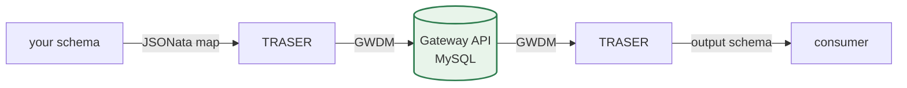

# Get started

**Applies to:** HDRUK 4.1.0 · GWDM 2.2

This site documents how metadata gets into and out of the HDR UK Gateway — the
schemas involved, the translation between them, and the APIs that carry them.

It serves two audiences in one place, because they read most of the same
reference material:

- **Data partners and third parties** — you have health data metadata and you
  want the Gateway to hold it, whether it is already in a schema we support or in
  a format of your own.
- **HDR UK developers** — you are adding a field, changing an enum, cutting a new
  schema version, or onboarding a new partner.

## The pipeline in one line

A partner schema is defined in `schemata`, mapped to the GWDM by JSONata in
`traser-mapping-files`, translated by TRASER, stored as GWDM by the Gateway API,
and translated back out to a requested output schema on read.

If that sentence raised more questions than it answered, that is expected — it is
unpacked in [key concepts](concepts.md), which is the one page everything else
assumes you have read.

## Start here

-   :material-map-marker-path: **Which path am I on?**

    ---

    Four journeys through this site. Two minutes to work out which is yours.

    [:octicons-arrow-right-24: Route yourself](choose-your-path.md)

-   :material-lightbulb-on: **Key concepts**

    ---

    Input schema, storage model, output schema, and why the GWDM is the
    bottleneck.

    [:octicons-arrow-right-24: The mental model](concepts.md)

-   :material-book-alphabet: **Glossary**

    ---

    GWDM, TRASER, JSONata, PID, partner context, GMI — defined once.

    [:octicons-arrow-right-24: Look something up](glossary.md)

-   :material-database-outline: **The GWDM**

    ---

    The single model every dataset is stored in, and the four conventions that
    decide whether your metadata survives it.

    [:octicons-arrow-right-24: What we store](../schemas/gwdm.md)

## If you are in a hurry

| You want to… | Go to |
|---|---|
| Submit a dataset in a schema we already support | [Create a dataset](../api/datasets/create.md) |
| Work out which schema to author in | [The schema landscape](../schemas/landscape.md) |
| Have us accept a schema of your own | [Bring your own schema](../byos/index.md) |
| Look up a GWDM field | [GWDM field reference](../schemas/gwdm-reference.md) |
| Authenticate against the API | [Making an authenticated request](../api/making-an-authenticated-request.md) |
| Change a schema, as an HDR UK developer | [Playbooks](../playbooks/index.md) |

## What is current

Two versions are treated as current throughout this site. Both are committed in
the repositories and neither is on the deployed development service yet — see
[the version matrix](../reference/version-matrix.md) before you build.

| | Current | Deployed on dev |
|---|---|---|
| HDRUK schema | **4.1.0** | 4.0.0 |
| GWDM | **2.2** | 2.1 |

Everything from HDRUK 2.0.2 and GWDM 1.0 onwards remains supported and documented.
