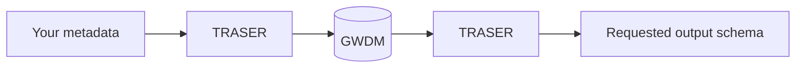

# Gateway Technical Guides

How dataset metadata gets **into** the HDR UK Gateway, what happens to it while
it is there, and what comes **back out**.

- :material-database-import: **I want the Gateway to accept my schema**

    ---
    You have metadata in your own format and you want the Gateway to take it.

    [:octicons-arrow-right-24: Bring your own schema](byos/index.md)

- :material-tools: **I'm an HDR UK developer changing a schema**

    ---
    Add a field, change an enum, cut a version, onboard a partner.

    [:octicons-arrow-right-24: Playbooks](playbooks/index.md)

- :material-api: **I just want to call the API**

    ---
    Authenticate, then create, read, update and delete dataset metadata.

    [:octicons-arrow-right-24: Gateway APIs](api/index.md)

- :material-book-open-variant: **I'm looking something up**

    ---
    Endpoints, the GWDM field reference, the JSONata cookbook, error codes.

    [:octicons-arrow-right-24: Reference](reference/index.md)

Not sure which of those you are? [Work out which path you are on](get-started/choose-your-path.md).

## The pipeline in one line

Your schema is defined in `schemata`, mapped to the GWDM by JSONata in
`traser-mapping-files`, translated by TRASER, stored as GWDM by the Gateway API,
and translated back out to whichever schema the reader asks for.

[Key concepts](get-started/concepts.md) unpacks each step.

## Services

| Service | Repo | Documentation |
|---|---|---|
| Gateway API | [`gateway-api-2`](https://github.com/HDRUK/gateway-api-2) | [API reference](https://api.healthdatagateway.org/api/documentation) |
| TRASER (translation) | [`traser`](https://github.com/HDRUK/traser) | [TRASER docs](https://hdr-gateway-traser-dev-qmnkcg5qjq-ew.a.run.app/docs/) |
| Schema definitions | [`schemata`](https://github.com/HDRUK/schemata) | [Schema site](https://hdruk.github.io/schemata/) |
| Translation maps | [`traser-mapping-files`](https://github.com/HDRUK/traser-mapping-files) | [JSONata cookbook](reference/jsonata-cookbook.md) |

!!! hdruk "HDR UK"
    This site is maintained by [Health Data Research UK](https://www.hdruk.ac.uk).
    It covers both the external integration journey and the internal
    schema-maintenance one — internal pages are marked as such.
