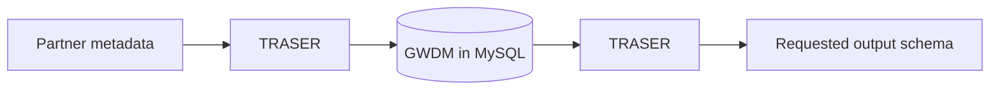

# Architecture

!!! warning "Under construction"
    This page is being written as part of the metadata documentation rewrite.
    Owner: plan A.

## What this page will cover

- The five repos and what each owns.
- The ingest path and the read path (`FACTS.md` F7).
- Where the GWDM handlers live in `gateway-api-2` and how `GwdmHandlerFactory` picks one.
- How the GWDM is physically stored: one JSON blob in `dataset_versions.metadata`,
  supplemented by relational linkage rows the handler extracts (gap G3).
- What a partner context actually configures — now including search scoping (gap G2).
- What indexes the GWDM: Typesense *and* Elasticsearch, both live today (gap G1).

## The pipeline

