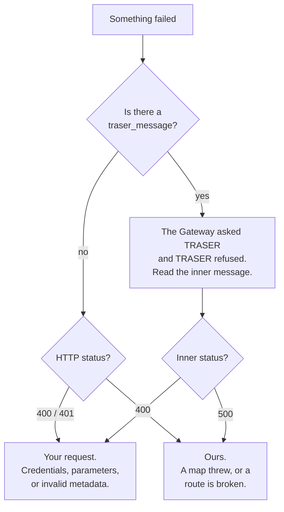

# Error reference

Every error body on this page was produced by making the failing call, not
written from a specification. Where the deployed service differs from the current
source, both are shown.

## Start here: whose fault is it?

Most confusing failures are one of three things. Check them in this order.



The single most useful habit: when a Gateway API response contains
`details.traser_message`, **the real error is inside it**. The outer
`"failed to translate"` tells you only which stage failed.

---

## Gateway API errors

### 401 — no credentials

```json
{ "code": 401, "message": "Unauthorized" }
```

You sent no `x-application-id` / `x-client-id` at all. Note the public read
endpoints (`/api/v1/datasets/{id}`, `/api/v2/datasets/{id}`) need no
authentication — if you are seeing this on a read, you are on
`/api/v1/integrations/...`, which does.

### 401 — credentials that do not match

```json
{ "code": 401, "message": "No known integration matches the credentials provided" }
```

Both headers arrived and neither matched an integration. Re-copy them from
`Integrations > API Management > Manage API > Authentication`. See
[making an authenticated request](../api/making-an-authenticated-request.md).

### 400 — app not enabled

```json
{ "code": 400, "message": "Application has not been enabled!" }
```

The credentials are right; the app is switched off. Enable it on the **App Info**
tab.

### 400 — unauthorised for this dataset

```json
{ "code": 400, "message": "Application permissions do not allow this request" }
```

Valid app, wrong team. The app can only act on datasets belonging to the team it
was created under.

### 400 — dataset does not exist

Note this is a **400, not a 404**, and it is Laravel's validation shape rather
than the `{code, message}` shape used elsewhere:

```json
{
  "status": "INVALID_ARGUMENT",
  "message": "Invalid argument(s)",
  "errors": [
    { "reason": "EXISTS", "message": "The selected id is invalid.", "field": "id" }
  ]
}
```

Confirmed identical on both `/api/v1/datasets/{id}` and `/api/v2/datasets/{id}`.

### 500 — dataset was deleted

```json
{ "code": 500, "message": "Dataset with id=<dataset_id> cannot be found" }
```

Different from the above: the id existed and the dataset has since been deleted.

### 500 — `schema_model` without `schema_version`

```json
{ "code": 500, "message": "You have given a schema_model but not a schema_version" }
```

The two query parameters are all-or-nothing. Send both or neither. A 500 for a
client mistake is misleading, but that is what it returns — do not go looking for
a server problem.

### 400 — unsupported `x-gwdm-version`

```json
{ "message": "Unsupported GWDM version '9.9'. Supported versions: 2.0, 2.1." }
```

Useful for a reason beyond fixing your header: the message **enumerates what
production actually supports**, which is the quickest way to check whether GWDM
2.2 has shipped.

!!! warning "This header is silently ignored on `/api/v1/`"
    An unrecognised `x-gwdm-version` returns **200** on `/api/v1/datasets/{id}`
    and **400** on `/api/v2/datasets/{id}`. That asymmetry is deliberate — the
    write path must never fail because of a stray header on an unrelated request
    — but it means a typo goes undetected on v1.
    [Choosing your response schema](../api/response-schema.md#x-gwdm-version)
    has the full behaviour.

### 404 — no dataset version at that GWDM version

```json
{ "message": "No dataset version found with GWDM version '2.1'." }
```

`x-gwdm-version` on a read **selects among the stored version rows**; it does not
translate. Dataset 868 is stored only at GWDM 2.0, so asking for 2.1 finds
nothing. Drop the header to get the newest stored version.

### 400 / 500 — translation failed

The wrapper is always the same and the content is always inside it:

```json
{
  "message": "failed to translate",
  "details": {
    "traser_message": {
      "message": "Failed to execute translation between GWDM:1.2 and GWDM:1.1",
      "details": []
    },
    "wasTranslated": false,
    "metadata": null,
    "statusCode": 500
  }
}
```

| Field | What it tells you |
|---|---|
| `traser_message` | **the real error** — a TRASER body, verbatim |
| `wasTranslated` | always `false` here |
| `metadata` | `null` on failure |
| `statusCode` | TRASER's status, which is what distinguishes your fault from ours |

That specific example is [the broken
hop](translation-graph.md#the-broken-hop) and it is not your doing. Compare with
a request-side failure, which carries an inner 400:

```json
{
  "message": "failed to translate",
  "details": {
    "traser_message": {
      "error": "Translation not found",
      "message": "Request failed with status code 404",
      "details": "Translation for GWDM-1.1 to HDRUK-2.2.3 is not implemented"
    },
    "wasTranslated": false,
    "metadata": null,
    "statusCode": 400
  }
}
```

`HDRUK 2.2.3` does not exist. Check [the version
matrix](version-matrix.md#the-matrix).

### 400 — metadata in an unknown format

The one you will hit most often on ingest:

```json
{
  "message": "metadata is in an unknown format and cannot be processed",
  "details": {
    "traser_message": {
      "message": "Input metadata object matched no known schemas",
      "details": {
        "available_schemas": {
          "HDRUK": ["2.0.2", "2.1.0", "2.1.2", "2.1.3", "2.2.0", "2.2.1", "3.0.0", "4.0.0"],
          "GWDM": ["1.0", "1.1", "1.2", "2.0", "2.1"],
          "CRUK": ["1.0.0"],
          "SchemaOrg": ["BioSchema", "default", "GoogleRecommended"]
        }
      }
    },
    "wasTranslated": false,
    "metadata": null,
    "statusCode": 400
  }
}
```

`available_schemas` is TRASER's live registry, so it doubles as an answer to
"what can I send you?" — but it does **not** tell you why your payload missed.
For that, take the same payload to `/find`:

```bash
TRASER=https://hdr-gateway-traser-dev-qmnkcg5qjq-ew.a.run.app

curl -s -X POST "$TRASER/find?with_errors=1" \
  -H 'Content-Type: application/json' --data @my-metadata.json \
  | jq '.[] | select(.name=="HDRUK" and .version=="4.0.0") | .errors'
```

Pick the schema you *meant* to send and read its errors. Nine times in ten it is
one missing required property.

---

## TRASER errors

### Parameter errors — the `errors` array shape

Missing or invalid query parameters produce a list, so one call tells you about
all of them:

```json
{
  "message": "Invalid query parameters.",
  "errors": [
    { "type": "field", "msg": "Invalid value", "path": "output_schema", "location": "query" },
    { "type": "field", "msg": "Invalid value", "path": "output_version", "location": "query" },
    { "type": "field", "msg": "Invalid value", "path": "input_version", "location": "query" }
  ]
}
```

`path` names the parameter and `location` says whether it was expected in the
`query` or the `body`. The leading `message` varies by endpoint — `/validate`
says `"Validation has failed"`, `/list/translations` says
`"Translation has failed."` — so **key off `errors`, not the message string.**

### 400 — content type

```json
{
  "errors": [
    {
      "type": "field",
      "value": { "{}": "" },
      "msg": "Invalid content type. Expected JSON.",
      "path": "",
      "location": "body"
    }
  ]
}
```

You forgot `-H 'Content-Type: application/json'`. The odd `value` is your body as
the parser managed to read it.

### 400 — malformed JSON

```json
{
  "expose": true,
  "statusCode": 400,
  "status": 400,
  "body": "{not json",
  "type": "entity.parse.failed"
}
```

That is the deployed dev service leaking its body-parser's internal error object.
The current source returns `{"message": "Invalid JSON body"}` instead. Either
way: your JSON is invalid, and `body` shows how far the parser got.

### 400 — schema is not a node in the graph

```json
{ "message": "Cannot support the output model (HDRUK:9.9.9)", "details": {} }
```

There is a matching `Cannot support the input model (…)`. "Not supported" here
means **not in the translation graph** — no maps reference it. A schema can be
loaded for validation and still not be a graph node; check
[`/list/templates`](traser-api.md#get-listtemplates), not `/list/schemas`.

### 400 — no route between two real nodes

Both endpoints exist and there is no path. Forwarded from the graph with both
ends named. Confirm with
[`/list/translations`](traser-api.md#get-listtranslations) — if the destination
is absent from that list, there is no route and no parameter will conjure one.

### 400 — input validation failed

```json
{
  "message": "Input metadata validation failed",
  "details": {
    "validationErrors": [
      {
        "instancePath": "",
        "schemaPath": "#/required",
        "keyword": "required",
        "params": { "missingProperty": "identifier" },
        "message": "must have required property 'identifier'"
      }
    ],
    "data": { "…your payload…" }
  }
}
```

Note `details.validationErrors` here, versus `details` being the array itself on
output failure and on `/validate`. Three endpoints, three nestings.

### 400 — output validation failed

```json
{
  "message": "Output metadata validation failed",
  "details": [{ "message": "Schema HDRUK:datasetv2 is not known" }],
  "data": { "…the translated metadata…" }
}
```

**Read `data` before you treat this as a failure.** The translation succeeded;
only the check on it failed, and the result is right there. `Schema X is not
known` specifically means the target has maps but no schema.

!!! note "GWDM 2.2 is no longer an example of this"
    2.2 gained its schema and is validated normally (checked 2026-09-21). The
    remaining permanent case is `HDRUK:datasetv2`, which has maps but will
    never have a schema.
Re-send with `validate_output=0`.

### 400 — metadata validation failed (`/validate`)

```json
{
  "error": "metadata validation failed",
  "details": [ "…AJV errors…" ],
  "data": { "…your payload…" }
}
```

Note `error`, not `message`, on this one. How to read the AJV array — and why one
mistake yields three entries — is on
[the API reference](traser-api.md#reading-the-error-array).

### 400 — ambiguous input schema

```json
{
  "message": "Input metadata object matched multiple schemas! Something could be wrong..",
  "details": [
    { "name": "GWDM", "version": "2.0", "matches": true },
    { "name": "GWDM", "version": "2.1", "matches": true }
  ]
}
```

Only when you pass `select_first_matching=false`. It is usually not a problem —
a valid GWDM 2.0 record is legitimately also a valid 2.1 record. Pass
`input_schema` and `input_version` explicitly and the question does not arise.

### 500 — a map threw

```json
{ "message": "Failed to execute translation between GWDM:1.2 and GWDM:1.1", "details": {} }
```

`details` is empty by design: unexpected 5xx errors are genericised so internal
detail cannot leak. The pair of schemas named is the failing **hop**, which may
be neither of the endpoints you asked for. This is ours to fix, not yours — but
you can route around it by
[translating hop by hop](translation-graph.md#how-to-force-a-specific-route).

### 400 — unknown schema on `/get/schema`

| | Body |
|---|---|
| Current source | `{"error": "Schema HDRUK:9.9.9 not found"}` |
| **Deployed dev** | `{"error": "Cannot read properties of undefined (reading 'schema')"}` |

If you get the second one, you have a typo in `version`, or you are asking for
something that exists only in the repositories. It is not a service fault.

### 413 — body too large

`{"message": "Request body too large (limit 512mb)"}`, from the `MAX_BODY_MB`
limit. Documented from configuration; not exercised here. If you hit it, suspect
your request rather than your dataset.

### 404 — unknown path

| | Response |
|---|---|
| **Deployed dev** | JSON: `{"message": "Not Found"}` |
| Current source | **HTML** — the app's error boundary, `Content-Type: text/html` |

!!! warning "A mistyped path will one day return HTML, not JSON"
    On the current TRASER source an unknown path renders the React error page.
    A client doing `response.json()` on it gets a parse error rather than a
    404 it can handle.

    Check `response.status` and `Content-Type` before parsing, and treat a
    `text/html` body as a routing mistake on your side. The paths most often
    mistyped: `/list/translations` (not `/translations` — which is what the
    deployed Swagger page tells you), and `/get/schema` (not `/schema`).

---

## Errors that are really configuration

Three failures look like bugs in your request and are not.

| Symptom | Actual cause |
|---|---|
| `schema_model=SchemaOrg&schema_version=BioSchema` → `failed to translate` with an inner 500 | The `GWDM 1.2 → 1.1` map is broken and sits on the only route. Nothing you can send fixes it. [Detail](translation-graph.md#the-broken-hop) |
| `x-partner-context: CRUK` → `Cannot support the output model (CRUK:1.1.0)` | The Gateway config points at a CRUK version that was never published. [Detail](version-matrix.md#where-the-numbers-diverge-and-why) |
| Anything targeting `HDRUK:datasetv2` → `Schema … is not known` | It has maps but no schema, permanently. Translate *out of* it; never validate *against* it. [Detail](version-matrix.md#hdrukdatasetv2-has-maps-but-no-schema-permanently) |

## A documented status code that is wrong

[The GMI overview](../api/gmi/index.md) tabulates HTTP **503** as
*"Gateway Timeout"*. 503 is **Service Unavailable**; 504 is Gateway Timeout. If
you are handling 503 from a federation health check, treat it as *the upstream is
down or refusing*, which is a different remedy from a timeout.

## Reporting one

If you have an error you cannot place, the useful bug report is four lines:

1. The exact request — method, full URL with query string, and body shape
   (`bare` or `{"metadata": …}`).
2. The **complete** response body, including `details.traser_message` if present.
3. Which host — the deployed dev TRASER, a local instance, or the Gateway API.
4. Whether [`/find`](traser-api.md#post-find) on the same payload matches
   anything.

The fourth line answers most reports on its own.
