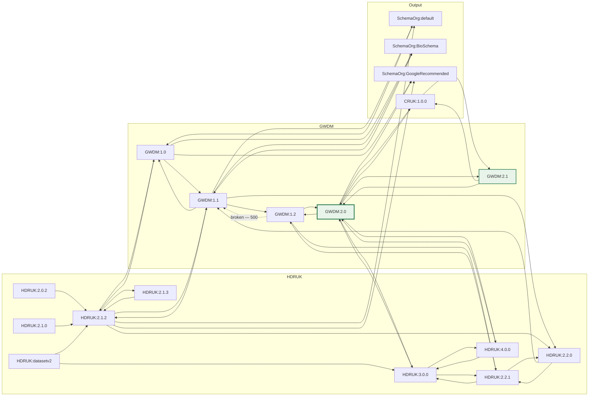

# Translation graph

**Applies to:** HDRUK 2.0.2 – 4.1.0 · GWDM 1.0 – 2.2

TRASER does not have a translator for every pair of schemas. It has a translator
for some pairs, and it **chains** them. That makes the set of available maps a
directed graph, and every question about what can be translated into what is a
question about that graph.

This page draws the graph as deployed, shows the routes it implies, and explains
the one property of it that will surprise you: the route TRASER picks is the
shortest, and the shortest route is not always the best one.

## How routing works

| | |
|---|---|
| **Nodes** | `{Schema}:{version}` — e.g. `GWDM:2.0`, `HDRUK:4.0.0` |
| **Edges** | one per `translation.jsonata` file, directed input → output |
| **Weights** | every edge is **1** |
| **Algorithm** | Dijkstra, so in practice: fewest hops |

The edge list comes from `GET /list/templates`, which is generated by scanning
`traser-mapping-files/maps/`. Add a map file, and a new edge appears in the graph
the next time TRASER refreshes its template cache — there is no separate routing
configuration to update.

When you `POST /translate`, TRASER finds the shortest path from your input node
to your output node and applies each map in turn, feeding each one's output into
the next. If no path exists you get a 400. If a map on the path throws, you get a
500 naming **that hop**, not your endpoints — which is why a translation you
never asked for can appear in an error message.

## The graph as deployed

46 edges over 18 nodes, captured from `/list/templates` on the deployed dev
service. The raw snapshot is
[`translation-templates.json`](../examples/translation-templates.json) and the
edge list is [`translation-edges.tsv`](../examples/translation-edges.tsv).



Four things to read off it:

1. **The GWDM is the hub.** Every input schema has an edge into the GWDM chain
   and every output schema has an edge out of it. Nothing translates directly
   from HDRUK to schema.org.
2. **`GWDM:1.1` and `GWDM:1.2` are not legacy dead ends.** They are load-bearing
   transit nodes. Two of the three schema.org outputs are only reachable through
   them.
3. **`HDRUK:datasetv2` has maps but no schema.** It is in `/list/templates` and
   not in `/list/schemas` — a legacy input you can translate out of but cannot
   validate against.
4. **Some edges are one-way.** `GWDM:2.0 → HDRUK:4.0.0` and
   `HDRUK:4.0.0 → GWDM:2.0` both exist, but `GWDM:2.1 → SchemaOrg:*` does not,
   despite `GWDM:2.0 → SchemaOrg:GoogleRecommended` existing. Do not assume
   symmetry.

    **Updated 2026-09-21 — the graph above is out of date.** The deployed dev
    TRASER now carries the 2.2 maps and reports **52 templates**, so `GWDM:2.2`
    and `HDRUK:4.1.0` are graph nodes and translations targeting them route
    normally. The six extra edges are listed below and should be merged into
    the diagram:

    ```text
    GWDM:2.1    -> GWDM:2.2         GWDM:2.2   -> GWDM:2.1
    HDRUK:4.1.0 -> GWDM:2.2         GWDM:2.2   -> HDRUK:4.1.0
    HDRUK:4.0.0 -> HDRUK:4.1.0      HDRUK:4.1.0 -> HDRUK:4.0.0
    ```

    Anything targeting `GWDM:2.2` still needs `validate_output=0`, because the
    node has maps but no schema.

## Asking the graph a question

Do not infer routes from the picture. Ask:

```bash
TRASER=https://hdr-gateway-traser-dev-qmnkcg5qjq-ew.a.run.app

curl -s "$TRASER/list/translations?schema=GWDM&version=2.1" | jq -r '.[]'
```

`/list/translations` returns every destination reachable from one node **with the
route written out**, which is both the answer to "can I get there?" and the
answer to "what will it go through?".

```text
GWDM:2.1 -> GWDM:2.0 -> HDRUK:4.0.0
GWDM:2.1 -> GWDM:2.0 -> SchemaOrg:GoogleRecommended
GWDM:2.1 -> GWDM:2.0 -> GWDM:1.2 -> GWDM:1.1 -> SchemaOrg:default
GWDM:2.1 -> GWDM:2.0 -> GWDM:1.2 -> GWDM:1.1 -> SchemaOrg:BioSchema
GWDM:2.1 -> CRUK:1.0.0
```

A destination that is unreachable is simply absent from the list. If a family you
expected is missing, there is no route — not a broken one.

## The routes that matter

Computed with all edges weight 1
([`translation-routes.tsv`](../examples/translation-routes.tsv), regenerate with
[`translation_graph.py`](../examples/translation_graph.py)):

| From | To | Hops | Route |
|---|---|---|---|
| `GWDM:2.0` | `SchemaOrg:GoogleRecommended` | 1 | direct |
| `GWDM:2.0` | `HDRUK:4.0.0` | 1 | direct |
| `GWDM:2.0` | `SchemaOrg:default` | 3 | `→ GWDM:1.2 → GWDM:1.1 →` |
| `GWDM:2.0` | `SchemaOrg:BioSchema` | 3 | `→ GWDM:1.2 → GWDM:1.1 →` |
| `GWDM:2.1` | `HDRUK:4.0.0` | 2 | `→ GWDM:2.0 →` |
| `GWDM:2.1` | `SchemaOrg:GoogleRecommended` | 2 | `→ GWDM:2.0 →` |
| `GWDM:2.1` | `SchemaOrg:default` | 4 | `→ GWDM:2.0 → GWDM:1.2 → GWDM:1.1 →` |
| `GWDM:2.1` | `SchemaOrg:BioSchema` | 4 | `→ GWDM:2.0 → GWDM:1.2 → GWDM:1.1 →` |
| `HDRUK:4.0.0` | `GWDM:2.0` | 1 | direct |
| `HDRUK:4.0.0` | `GWDM:2.1` | 2 | `→ GWDM:2.0 →` |
| `HDRUK:2.1.2` | `GWDM:2.0` | 3 | `→ GWDM:1.1 → GWDM:1.2 →` |
| `SchemaOrg:default` | `GWDM:2.0` | 4 | `→ GWDM:1.0 → GWDM:1.1 → GWDM:1.2 →` |

## The pitfall: shortest is not best

!!! danger "Every edge has weight 1, so routing optimises for hop count, not fidelity"
    TRASER has no notion of how much metadata a map preserves. A one-hop map
    written years ago against an older target beats a four-hop chain that would
    have carried more fields, every time, and there is no parameter that asks for
    the richer route.

The clearest case is in the table above. A record stored as **GWDM 2.1** reaching
Google Dataset output travels **backwards through GWDM 2.0** — because the only
edge into `SchemaOrg:GoogleRecommended` from the 2.x family starts at 2.0. The
five sections GWDM 2.1 added (`summary.funders`, `icons`, `projectGrants`,
`datasetFilters`, `erd`) have nowhere to go on that hop, so they are dropped
before the schema.org map ever sees them.

Nothing in the response tells you this happened. You get a 200 and a valid
schema.org document that is quietly missing things.

### How to see which route was taken

You cannot, from a `/translate` response. Ask separately:

```bash
curl -s "$TRASER/list/translations?schema=GWDM&version=2.1" \
  | jq -r '.[] | select(endswith("SchemaOrg:GoogleRecommended"))'
# GWDM:2.1 -> GWDM:2.0 -> SchemaOrg:GoogleRecommended
```

That is the route `/translate` will use, computed by the same graph and the same
algorithm.

### How to force a specific route

Translate one hop at a time. Each `/translate` call with explicit
`input_*`/`output_*` on adjacent nodes is a single map evaluation, so a sequence
of them is a route you chose:

```bash
# hop 1: GWDM 2.1 -> GWDM 2.0
jq '{metadata: .}' record.json > body.json
curl -s -X POST "$TRASER/translate?input_schema=GWDM&input_version=2.1&output_schema=GWDM&output_version=2.0" \
  -H 'Content-Type: application/json' --data @body.json \
  | jq '{metadata: .}' > hop1.json

# hop 2: GWDM 2.0 -> SchemaOrg:GoogleRecommended
curl -s -X POST "$TRASER/translate?input_schema=GWDM&input_version=2.0&output_schema=SchemaOrg&output_version=GoogleRecommended" \
  -H 'Content-Type: application/json' --data @hop1.json
```

Two reasons to do this even when the automatic route is the one you wanted:

- **You find out which hop fails.** A multi-hop 500 names the failing pair, but
  you cannot inspect the intermediate payload; hop by hop, you can.
- **You can see what each hop drops.** Diff the input and output of a single hop
  and the loss is attributable.

The real fix for a lossy route is a new edge — a direct map from the richer
source to the target. That both improves fidelity and shortens the path, so
Dijkstra will prefer it automatically.
[Write a JSONata translation map](../playbooks/write-a-map.md) is the playbook.

## The broken hop

!!! danger "`GWDM:1.2 → GWDM:1.1` returns HTTP 500, and it sits on the only route to two output schemas"
    ```bash
    curl -s -X POST "$TRASER/translate?input_schema=GWDM&input_version=1.2&output_schema=GWDM&output_version=1.1" \
      -H 'Content-Type: application/json' --data @body.json
    ```

    ```json
    {
      "message": "Failed to execute translation between GWDM:1.2 and GWDM:1.1",
      "details": {}
    }
    ```

    Reproduced with three different payloads — the rich, minimal and awkward
    [frozen fixtures](../examples/README.md) — and with
    `validate_input=0&validate_output=0`. It is the map, not the data and not
    validation.

Look at where that edge sits in the route table. `SchemaOrg:default` and
`SchemaOrg:BioSchema` have no inbound edge from GWDM 2.x at all:

| Target | Inbound edges |
|---|---|
| `SchemaOrg:default` | `GWDM:1.1`, `HDRUK:2.1.2` |
| `SchemaOrg:BioSchema` | `GWDM:1.0`, `GWDM:1.1` |
| `SchemaOrg:GoogleRecommended` | `GWDM:1.0`, **`GWDM:2.0`**, `HDRUK:2.1.2` |

So the only route from a stored record to either of them is
`GWDM 2.0 → 1.2 → 1.1 → SchemaOrg`, which crosses the broken edge.
**schema.org `default` and BioSchema output are therefore unavailable for every
stored dataset.** `GoogleRecommended` is unaffected, because it has that direct
`GWDM:2.0` edge.

Through the Gateway API the same failure looks like this:

```bash
curl -s "https://api.healthdatagateway.org/api/v1/datasets/868?schema_model=SchemaOrg&schema_version=BioSchema"
```

```json
{
  "message": "failed to translate",
  "details": {
    "traser_message": {
      "message": "Failed to execute translation between GWDM:1.2 and GWDM:1.1",
      "details": []
    },
    "wasTranslated": false,
    "metadata": null,
    "statusCode": 500
  }
}
```

The frozen failure responses are kept in
[`schemaorg-default-*.json`](../examples/schemaorg-default-rich.json) and
[`schemaorg-bioschema-*.json`](../examples/schemaorg-bioschema-rich.json)
deliberately — they are what a caller receives today.

Adding a `GWDM:2.x → SchemaOrg:BioSchema` edge would fix the fidelity problem
*and* route around the broken hop in one change. That is
[the schema.org worked example](../byos/example-schemaorg.md)'s problem to solve.

## Adding to the graph

A new edge is a new file at
`maps/{OutputModel}/{outputVersion}/{InputModel}/{inputVersion}/translation.jsonata`
in `traser-mapping-files`, plus the regenerated registry:

```bash
python utils/list_maps.py   # rescan maps/** -> rewrite available.json
python utils/visualise.py   # optional: pyvis -> network_map.html
```

Commit the map and the regenerated `available.json` **together** — TRASER reads
the registry, so a map without a registry entry is invisible.

Before writing one, work out whether you need it. Ask `/list/translations`
whether the destination is already reachable, and if it is, whether the existing
route loses anything you care about. A new edge is worth it when the answer is
"reachable, but only through a version that predates my fields" — which is the
common case, and the one the whole of this page is about.
