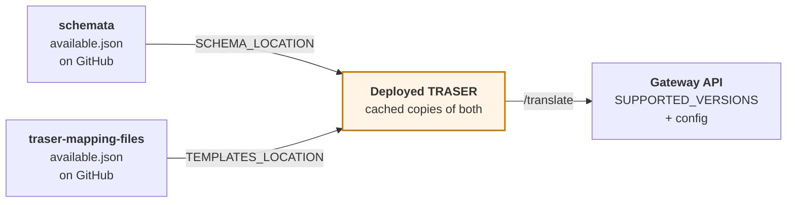

# Schema version matrix

**Applies to:** HDRUK 2.0.2 – 4.1.0 · GWDM 1.0 – 2.2

"Is version X supported?" has four different answers depending on what you mean,
and they do not agree. A version can be defined in the schema repository but not
deployed, deployed but with no translation map, or have a map but no schema at
all. This page separates them.

Read it before you build against a version number you found in a repository.

## The four questions

| Column | Question | Source of truth |
|---|---|---|
| **`schemata`** | Is it published in the schema repository? | [`available.json`](https://github.com/HDRUK/schemata/blob/main/available.json) on `HDRUK/schemata` |
| **In flight** | Is it in an unreleased branch? | the local working branch for HDRUK 4.1.0 |
| **TRASER** | Can the deployed service validate against it *today*? | `GET /list/schemas` |
| **Maps** | Which GWDM versions does it translate directly to and from? | `GET /list/templates` |

The gap between columns two and three is the one that causes trouble: a version
can be complete in `schemata` and still be unusable, because the deployed TRASER
holds its own cached copy of the registry.

## The matrix

Captured 2026-09-10, **rows corrected 2026-09-21**. `→ GWDM` and `GWDM →` list
**direct** edges only; a version with `–` in both can still reach the GWDM
through a sibling version.

| Schema:version | `schemata` | In flight | TRASER (dev) | → GWDM | GWDM → | Notes |
|---|:-:|:-:|:-:|---|---|---|
| `HDRUK:2.0.2` | ✅ | ❌ | ✅ | – | – | Generated schema only, no Pydantic source — see below |
| `HDRUK:2.1.0` | ✅ | ❌ | ✅ | – | – | Generated schema only, no Pydantic source — see below |
| `HDRUK:2.1.2` | ✅ | ✅ | ✅ | 1.0, 1.1 | 1.0, 1.1 | The root base model for the HDRUK family |
| `HDRUK:2.1.3` | ✅ | ✅ | ✅ | – | – | Reaches the GWDM via 2.1.2 |
| `HDRUK:2.2.0` | ✅ | ✅ | ✅ | 1.1 | 1.1 | |
| `HDRUK:2.2.1` | ✅ | ✅ | ✅ | 1.2 | 1.2 | |
| `HDRUK:3.0.0` | ✅ | ✅ | ✅ | 2.0 | 2.0 | Still the default in older docs; prefer 4.1.0 |
| `HDRUK:4.0.0` | ✅ | ✅ | ✅ | 2.0 | 2.0 | **What the Gateway API returns by default** |
| `HDRUK:4.1.0` | ❌ | ✅ | ❌ | 2.2 | 2.2 | Latest. Also maps to and from 4.0.0 |
| `HDRUK:datasetv2` | ❌ | ❌ | ❌ | – | – | **Maps but no schema** — see below |
| `GWDM:1.0` | ✅ | ✅ | ✅ | 1.1 | 1.1 | |
| `GWDM:1.1` | ✅ | ✅ | ✅ | 1.0, 1.2 | 1.0, 1.2 | Transit node for two schema.org outputs |
| `GWDM:1.2` | ✅ | ✅ | ✅ | 1.1, 2.0 | 1.1, 2.0 | The `→ 1.1` edge is **broken** |
| `GWDM:2.0` | ✅ | ✅ | ✅ | 1.2, 2.1 | 1.2, 2.1 | **The default storage version** |
| `GWDM:2.1` | ✅ | ✅ | ✅ | 2.0, 2.2 | 2.0, 2.2 | Storage version for the 20 CRUK-context records |
| `GWDM:2.2` | ❌ | ❌ | ❌ | 2.1 | 2.1 | **Maps but no schema** — see below |
| `CRUK:1.0.0` | ✅ | ✅ | ✅ | 2.0, 2.1 | 2.0, 2.1 | The only published CRUK version |
| `SchemaOrg:default` | ✅ | ✅ | ✅ | 1.0 | 1.1 | Output **broken** — no working route |
| `SchemaOrg:BioSchema` | ✅ | ✅ | ✅ | 1.1 | 1.0, 1.1 | Output **broken** — no working route |
| `SchemaOrg:GoogleRecommended` | ✅ | ✅ | ✅ | – | 1.0, 2.0 | Output-only, and it works |

### What to use

| If you are… | Use |
|---|---|
| a data partner submitting metadata | **HDRUK 4.1.0**, or 4.0.0 until 4.1.0 deploys |
| reading metadata back out | **HDRUK 4.0.0** — the default, no parameters needed |
| publishing for search engines | **`SchemaOrg:GoogleRecommended`** |
| writing a map into storage | target **GWDM 2.0**, unless you have a reason for 2.1 |

## The three awkward cases

### `HDRUK:2.0.2` and `2.1.0` are validated from generated schema only

**Corrected 2026-09-21.** An earlier revision of this page said both were
*being withdrawn* and would stop working when the HDRUK 4.1.0 branch released.
**That did not happen.** 4.1.0 has released, and both versions are present in
`available.json` and served by the deployed TRASER. They validate today.

What is true is narrower, and still worth knowing:

| | |
|---|---|
| Generated `schema.json` directories | ✅ present for both |
| Pydantic **source** packages (`v2_0_2`, `v2_1_0`) | ❌ do not exist |
| `models/HDRUK/__init__.py` | starts at `v2_1_2` |

So both are validated from a **generated artefact with no source behind it**.
They cannot be regenerated or amended — only deleted. Neither has a direct GWDM
edge; both reach storage through `HDRUK:2.1.2`.

**Do not start anything new on either**, but do not expect them to disappear on
a schedule either — nothing schedules it.

!!! info "This is the worked example of a missing process"
    These two were removed from the registry, then reinstated, with no record
    of either decision. The Gateway has **no defined process for
    decommissioning a schema version** — which is why a page like this has to
    be corrected rather than consulted.

### `GWDM:2.2` and `HDRUK:4.1.0` are complete

**Re-verified 2026-09-21.** Both are finished and deployed. Earlier revisions of
this page described 2.2 as having maps but no schema — that is no longer true.

| | |
|---|---|
| `Gwdm22Handler` in the Gateway API | ✅ exists |
| `GwdmHandlerFactory::SUPPORTED_VERSIONS` | ✅ `['2.0', '2.1', '2.2']` — **including production** |
| `maps/GWDM/2.2/**` and `maps/**/GWDM/2.2/` | ✅ present |
| `models/GWDM/v2_2/` in `schemata` | ✅ exists |
| `GWDM:2.2` in `available.json` | ✅ present |
| `GWDM:2.2` on the deployed TRASER | ✅ a graph node; **52 templates** |
| `HDRUK:4.1.0` on production | ✅ returns a translated payload |

`/translate` targeting `GWDM:2.2` **no longer needs `validate_output=0`** —
TRASER can both produce the shape and check it.

!!! warning "One real gap remains"
    `maps/GWDM/2.2/HDRUK/4.1.0/` was built by copying the GWDM 2.0-targeted map
    and adding the DUO fields, so it emits 2.0's fields plus DUO and **not** the
    five sections GWDM 2.1 introduced. GWDM 2.2 *extends* 2.1, so this is a map
    defect with a known fix, not a property of the schema.

You can confirm what production supports without reading any source:

```bash
curl -s -H 'x-gwdm-version: 9.9' \
  "https://api.healthdatagateway.org/api/v2/datasets/868"
```

```json
{ "message": "Unsupported GWDM version '9.9'. Supported versions: 2.0, 2.1, 2.2." }
```

GWDM 2.2 **extends 2.1** — it is a superset, not a branch. See
[the GWDM version history](../schemas/gwdm.md#how-22-relates-to-21).

### `HDRUK:datasetv2` has maps but no schema, permanently

It appears in `/list/templates` as an input to `HDRUK:2.1.2` and `HDRUK:3.0.0`,
and it is in no `available.json` anywhere. It is the pre-GWDM Gateway 1
metadata shape, kept translatable so historic records can be brought forward.

You can translate **out of** it. You cannot validate **against** it, and
`/get/schema?name=HDRUK&version=datasetv2` returns a not-found error. Nobody
should be authoring in it.

## Where the numbers diverge, and why

Three registries hold a list of versions, and they are updated at different
times:



- **`schemata`** decides what can be *validated*. A version with no entry there
  cannot be validated even if maps exist.
- **`traser-mapping-files`** decides what can be *translated*. A version with no
  maps is an isolated node.
- **The deployed TRASER** decides what works *today*. It caches both registries
  and refreshes on a TTL, so a merge to `schemata` is not live instantly — and a
  build that predates a feature is not live at all, which is the current
  situation on dev.
- **The Gateway API** has its own opinion about GWDM versions in
  `GwdmHandlerFactory::SUPPORTED_VERSIONS`, and its own default output schema in
  `config/partners.php`. Those can disagree with TRASER, and one of them
  currently does:

!!! danger "The CRUK partner context is broken because of exactly this"
    `config/partners.php` sets CRUK's default output schema to **`1.1.0`**.
    `schemata` and TRASER only publish CRUK **`1.0.0`**. So every read under the
    CRUK partner context asks TRASER for a schema that does not exist:

    ```bash
    curl -s -H 'x-partner-context: CRUK' \
      "https://api.dev.hdruk.cloud/api/v2/datasets/2187"
    ```

    ```json
    {
      "message": "failed to translate",
      "details": "{\"message\":\"Cannot support the output model (CRUK:1.1.0)\", …}"
    }
    ```

    Cutting CRUK 1.1.0 in `schemata`, or correcting the config to `1.0.0`, would
    fix it. Until then, pass `?schema_model=CRUK&schema_version=1.0.0`
    explicitly instead of relying on the partner context. See
    [choosing your response schema](../api/response-schema.md#x-partner-context).

## Regenerating this table

Three commands, and the matrix falls out of comparing them:

```bash
TRASER=https://hdr-gateway-traser-dev-qmnkcg5qjq-ew.a.run.app

# 1. what the deployed service can validate against
curl -s "$TRASER/list/schemas"

# 2. every translation edge it holds
curl -s "$TRASER/list/templates"

# 3. what the schema repository publishes
curl -s https://raw.githubusercontent.com/HDRUK/schemata/main/available.json
```

To fill the **In flight** column you need the working branch of
[`HDRUK/schemata`](https://github.com/HDRUK/schemata) checked out locally, and
its own `available.json`, which is regenerated by
`python hdr_schemata/utils/build.py`.

The `→ GWDM` and `GWDM →` columns are derivable from (2) with a filter — take
each row of `/list/templates` as the directed edge
`input_model:input_version → output_model:output_version`, then keep the ones
where either end is a `GWDM` node.
[`translation_graph.py`](../examples/translation_graph.py) already does the
inversion and writes
[`translation-edges.tsv`](../examples/translation-edges.tsv).

!!! note "HDRUK 5.0.0 and GWDM 3.0 are deliberately absent"
    Both were drafted and both have since been removed from the schema
    repository's registry. They are out of scope for this documentation. If you
    find a reference to either, it predates that removal.
