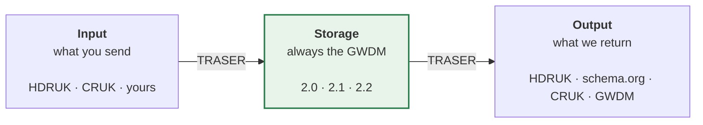

# Metadata & schemas

**Applies to:** HDRUK 2.0.2 – 4.1.0 · GWDM 1.0 – 2.2

Everything about the shapes metadata takes on its way through the Gateway: what
you can send, what we store, and what we can give back.

## The three roles a schema plays

A schema is not inherently an "input" or an "output" schema — it is whichever one
you are using it as. What is fixed is the middle: **storage is always the GWDM.**

The three are set independently: you can send HDRUK 4.1.0, have it stored as
GWDM 2.0, and read it back as schema.org. See
[key concepts](../get-started/concepts.md#three-things-people-conflate).

## The pages

-   :material-map: **The schema landscape**

    ---

    All four families, which direction each works in, and which one you should be
    using. Start here if you are choosing.

    [:octicons-arrow-right-24: The landscape](landscape.md)

-   :material-database-outline: **The GWDM**

    ---

    The internal storage model, its version history, and the four conventions
    that decide whether your metadata survives it.

    [:octicons-arrow-right-24: What we store](gwdm.md)

-   :material-table-search: **GWDM field reference**

    ---

    Every field in GWDM 2.0, 2.1 and 2.2 — path, type, enum, and which version
    introduced it. Generated from the schemas.

    [:octicons-arrow-right-24: Field reference](gwdm-reference.md)

-   :material-file-document-check: **HDRUK schema**

    ---

    The recommended input schema. What 4.1.0 adds, and what "supported" means for
    every version back to 2.0.2.

    [:octicons-arrow-right-24: HDRUK schema](hdruk.md)

-   :material-account-group: **Partner & output schemas**

    ---

    Partner contexts, `x-partner-context`, CRUK as the live precedent, and the
    schema.org family.

    [:octicons-arrow-right-24: Partner schemas](partner-schemas.md)

-   :material-pencil-outline: **Creating metadata**

    ---

    Authoring your first record, with runnable examples in Python and cURL.

    [:octicons-arrow-right-24: Creating metadata](creating-metadata.md)

-   :material-check-decagram: **Validation**

    ---

    Checking a payload against a schema, and detecting which schema it already
    matches.

    [:octicons-arrow-right-24: Validation](validation.md)

-   :material-code-json: **Example payloads**

    ---

    The same real dataset in four different schemas, frozen so it cannot drift.

    [:octicons-arrow-right-24: Examples](examples.md)

## What is live today

| Family | Current version | Deployed on dev | Role |
|---|---|---|---|
| **HDRUK** | 4.1.0 | 4.0.0 | input and output |
| **GWDM** | 2.2 | 2.1 | storage |
| **CRUK** | 1.0.0 | 1.0.0 | partner, both directions |
| **SchemaOrg** | — | `default`, `GoogleRecommended`, `BioSchema` | output |

The current column means *in the repositories*. The gap between the two columns
is normal and is usually one version wide — see
[the version matrix](../reference/version-matrix.md).

!!! danger "Two output schemas are broken right now"
    `SchemaOrg:default` and `SchemaOrg:BioSchema` return
    `{"message": "failed to translate"}` for every stored dataset, because the
    only route to them crosses a map that returns HTTP 500.
    `GoogleRecommended` is fine. Detail on
    [the schema landscape](landscape.md#two-things-the-diagram-is-telling-you).

## Where the definitions live

Schemas are not defined in this repository. They are Pydantic v2 models in
[**`HDRUK/schemata`**](https://github.com/HDRUK/schemata), which generates the
JSON Schema files and the published field documentation at
[hdruk.github.io/schemata](https://hdruk.github.io/schemata/).

The translation maps between them live in
[**`HDRUK/traser-mapping-files`**](https://github.com/HDRUK/traser-mapping-files).
