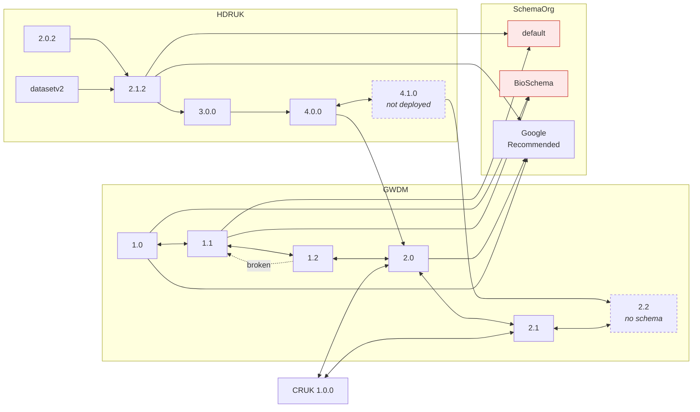

# The schema landscape

**Applies to:** HDRUK 2.0.2 – 4.1.0 · GWDM 1.0 – 2.2

Four schema families, eighteen `Model:version` nodes, forty-six translation maps
between them. This page is the map of the territory: what each family is for,
which direction it works in, and which one you should be using.

## Which schema should I use?

Start here. Most readers need one line of this table.

| If you are… | Use | Why |
|---|---|---|
| A UK health data custodian onboarding a dataset | **HDRUK 4.1.0** | The recommended input schema, and the most complete |
| Publishing for search-engine discovery | **Nothing — we do it for you** | The Gateway generates schema.org output from your stored record |
| A partner organisation with your own portal | **A partner context** | See [partner & output schemas](partner-schemas.md) |
| Holding metadata in your own catalogue format | **Your own schema** | See [Bring your own schema](../byos/index.md) |
| Reading Gateway metadata programmatically | **HDRUK 4.x, or raw GWDM** | Ask for it with `x-schema-model` / `x-schema-version` |

If you have a free choice and no existing format to preserve, use **HDRUK
4.1.0**. Everything else on this page is detail you can come back for.

## The four families

### HDRUK

The public-facing HDR UK health data metadata schema — the one a data custodian
authors in, and the one most consumers read. Versions 2.0.2 through 4.1.0, with
4.1.0 current. Owned by HDR UK, defined in
[`HDRUK/schemata`](https://github.com/HDRUK/schemata).

There is also a legacy `HDRUK:datasetv2` node, which is a pre-2.0 format kept
alive for inbound translation only. See [HDRUK schema](hdruk.md).

### GWDM

The Gateway Working Data Model — the internal storage model. Versions 1.0
through 2.2. **Nobody authors in the GWDM by hand**, but you will read it,
because it is what you get back if you request no output schema at all. See
[The GWDM explained](gwdm.md).

### SchemaOrg

Three output shapes built for discovery rather than for data access:

- **`GoogleRecommended`** — [Google Dataset Search](https://datasetsearch.research.google.com/)'s
  recommended subset of schema.org `Dataset`
- **`default`** — plain schema.org `Dataset`
- **`BioSchema`** — the [Bioschemas](https://bioschemas.org/) life-sciences profile

### CRUK

Cancer Research UK's own metadata shape, version 1.0.0. The only non-HDRUK
partner schema live today. It is fully bidirectional with the GWDM, which makes
it the working precedent for any new partner — see
[partner & output schemas](partner-schemas.md).

## Input, output, or both?

**Derived from the deployed translation edges, not from intent.** A family can
only be used as an input if some map consumes it, and as an output if some map
produces it.

| Family | Versions usable as **input** | Versions usable as **output** | Direction |
|---|---|---|---|
| **HDRUK** | 9 — `2.0.2`, `2.1.0`, `2.1.2`, `2.1.3`, `2.2.0`, `2.2.1`, `3.0.0`, `4.0.0`, `datasetv2` | 6 — `2.1.2`, `2.1.3`, `2.2.0`, `2.2.1`, `3.0.0`, `4.0.0` | both |
| **GWDM** | 5 — `1.0`, `1.1`, `1.2`, `2.0`, `2.1` | 5 — same | both |
| **CRUK** | `1.0.0` | `1.0.0` | both |
| **SchemaOrg** | 2 — `BioSchema`, `default` | 3 — `BioSchema`, `default`, `GoogleRecommended` | mostly out |

### The asymmetries worth knowing

**`SchemaOrg` is output-only in practice.** `default` and `BioSchema` do each
have an inbound map to the GWDM, so the table above shows them as inputs — but
nobody submits metadata to the Gateway as schema.org, and the inbound maps exist
mainly to complete the graph. Treat the family as an output.

**`HDRUK:2.0.2`, `2.1.0` and `datasetv2` are input-only.** You can send them; you
cannot ask for them back. They are legacy formats with a one-way path into the
model.

**`HDRUK:datasetv2` translates into 2.1.2 and 3.0.0 only.** It is not wired to
the current versions, so a `datasetv2` payload reaches 4.x by chaining forward
through the intermediate versions.

**`CRUK:1.0.0` is bidirectional with GWDM 2.0 and 2.1.** That is what makes a
partner context work: read *and* write in the partner's own shape.

## Deployed versus in the repositories

These two lists differ, and they will keep differing. A version exists in the
repositories before it is deployed, so "current" and "available to you right now"
are not the same claim.

| Family | Deployed dev TRASER serves | The repositories contain |
|---|---|---|
| HDRUK | `2.0.2` `2.1.0` `2.1.2` `2.1.3` `2.2.0` `2.2.1` `3.0.0` `4.0.0` | the same, **plus `4.1.0`** |
| GWDM | `1.0` `1.1` `1.2` `2.0` `2.1` | the same, **plus a `2.2` with maps but no schema** |
| CRUK | `1.0.0` | `1.0.0` |
| SchemaOrg | `BioSchema` `default` `GoogleRecommended` | the same |

So **HDRUK 4.1.0 and GWDM 2.2 are documented on this site as current, and are
not yet callable on the deployed dev service.** Check
[the schema version matrix](../reference/version-matrix.md) before building
against either, and see [HDRUK schema](hdruk.md) for what 4.1.0 adds.

The published field documentation at
[hdruk.github.io/schemata](https://hdruk.github.io/schemata/) lags further still
— it currently carries GWDM ≤ 2.0 and HDRUK ≤ 4.0.0. Pages for GWDM 2.1 and
HDRUK 4.1.0 are on their way.

## How they connect

Every arrow is a JSONata map. Every node is a `Model:version` pair. TRASER routes
across this graph with Dijkstra's algorithm, so a translation with no direct map
still works — it just takes several hops.

Simplified — the intermediate HDRUK versions `2.1.0`, `2.1.3`, `2.2.0` and
`2.2.1` are collapsed. The full 46-edge snapshot is on
[the translation graph](../reference/translation-graph.md).

### Two things the diagram is telling you

!!! danger "schema.org `default` and BioSchema output are broken today"
    The only route from a stored GWDM 2.x record to `SchemaOrg:default` or
    `SchemaOrg:BioSchema` runs `GWDM 2.0 → 1.2 → 1.1 → SchemaOrg`, and the
    `GWDM 1.2 → 1.1` hop returns HTTP 500. That single broken edge makes both
    output schemas unavailable for **every one of the 1,364 stored datasets**.

    `GoogleRecommended` is unaffected — it has a direct edge from GWDM 2.0.

    Requesting either one gets you `{"message": "failed to translate"}`. The
    frozen failure responses are in
    [`docs/examples/`](../examples/README.md) so you can see exactly what a
    caller receives.

**The shortest route is not the most faithful one.** Every edge has weight 1, so
TRASER minimises hop count and nothing else. A GWDM 2.1 record read as
`GoogleRecommended` goes back through GWDM 2.0 and loses the five 2.1-only blocks
on the way. There is currently no way to ask for a longer, higher-fidelity route.

## Where next

- [The GWDM explained](gwdm.md) — the storage model in detail
- [HDRUK schema](hdruk.md) — the recommended input schema
- [Partner & output schemas](partner-schemas.md) — CRUK, schema.org, and partner contexts
- [GWDM field reference](gwdm-reference.md) — every field, generated
- [Bring your own schema](../byos/index.md) — if none of these fit
