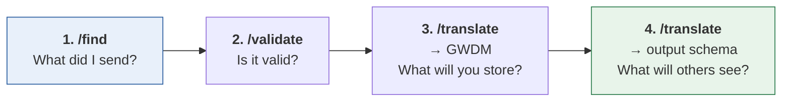

# Validating your metadata

**Applies to:** HDRUK 2.0.2 – 4.1.0 · GWDM 1.0 – 2.2

You do not have to submit metadata to find out whether it is acceptable. TRASER
will tell you, for free, with no authentication, in four calls — and the fourth
one tells you something an ingest never will.

Do this before you build an integration, not after.

## The four questions

Run them in this order. Each one answers a different question, and the order
matters because a failure at step *n* makes step *n+1* meaningless.



| Step | Answers | Fails when |
|---|---|---|
| **1. `/find`** | Which schemas does my payload match? | You believe you are sending 4.0.0 and you are sending something else |
| **2. `/validate`** | Exactly what is wrong with it? | You have a specific target and want the complete error list |
| **3. `/translate` → GWDM** | What will the Gateway actually store? | Your field has nowhere to live in the storage model |
| **4. `/translate` → out** | What will a consumer of your data receive? | Your record is valid but unusable downstream |

**Step 4 is the one people skip and the one that pays.** Steps 1 to 3 tell you
the Gateway will accept your metadata. Step 4 tells you whether it is any good
once accepted — and those are genuinely different answers, as the worked example
below shows.

Every sample here opens by setting the base URL:

```bash
TRASER=https://hdr-gateway-traser-dev-qmnkcg5qjq-ew.a.run.app
```

The URL itself, and why it is only written down once, is on
[the TRASER API reference](../reference/traser-api.md#the-base-url).

---

## Step 1 — `/find`: what did I send?

=== "cURL"

    ```bash
    curl -s -X POST "$TRASER/find" \
      -H 'Content-Type: application/json' \
      --data @my-metadata.json
    ```

=== "Python"

    ```python
    import json
    import os

    import requests

    TRASER = os.environ["TRASER"]     # set once — see above

    metadata = json.load(open("my-metadata.json"))

    # the BARE metadata object — see the warning below
    response = requests.post(f"{TRASER}/find", json=metadata, timeout=60)
    print([f"{e['name']}:{e['version']}" for e in response.json() if e["matches"]])
    ```

Run against [`hdruk-4.0.0-minimal.json`](../examples/hdruk-4.0.0-minimal.json):

```json
[ { "name": "HDRUK", "version": "4.0.0", "matches": true } ]
```

One match, so there is no ambiguity about what this is. A GWDM record typically
matches two — `GWDM:2.0` **and** `GWDM:2.1`, because everything 2.1 added is
optional. That is normal.

!!! danger "Do not wrap the body for `/find`"
    `/find` takes the **bare** metadata object. `/translate` and `/validate` take
    it wrapped in `{"metadata": …}`. Send the wrapper to `/find` and you get
    HTTP **200** with `matches: false` for every schema and a
    *"must have required property …"* message — because AJV is validating your
    wrapper, which is not metadata in any schema.

    It is a silent failure and it looks exactly like a badly broken payload.
    Earlier versions of this page made this mistake in their own sample.

### When nothing matches

Add `with_errors=1` and read the errors for the schema you *meant* to send:

```bash
curl -s -X POST "$TRASER/find?with_errors=1" \
  -H 'Content-Type: application/json' --data @my-metadata.json \
  | jq '.[] | select(.name=="HDRUK" and .version=="4.0.0") | .errors'
```

Nine times in ten it is one missing required property:

```json
[
  {
    "instancePath": "/summary",
    "schemaPath": "#/required",
    "keyword": "required",
    "params": { "missingProperty": "dataCustodian" },
    "message": "must have required property 'dataCustodian'"
  }
]
```

`instancePath` is a JSON Pointer into **your** payload — that is the thing to
fix. `schemaPath` points into the schema and is only useful for finding an enum
definition.

!!! warning "Check the version you are targeting is actually served"
    `/find` can only match schemas the service has loaded, so a payload can
    match nothing simply because its schema is absent — not because it is
    invalid. Run `curl -s "$TRASER/list/schemas"` first, or see
    [the version matrix](../reference/version-matrix.md).

    HDRUK 4.1.0 and GWDM 2.2 used to be the examples here; **both are now
    served** (checked 2026-09-21). The check is still worth doing for any
    schema you have not confirmed.

---

## Step 2 — `/validate`: exactly what is wrong?

Once you know your target, `/validate` gives you the **complete** list rather
than the first problem. AJV runs with `allErrors: true`, which is what makes it
worth looping on.

=== "cURL"

    ```bash
    # note the wrapper this time
    jq '{metadata: .}' my-metadata.json > body.json

    curl -s -X POST "$TRASER/validate?input_schema=HDRUK&input_version=4.0.0" \
      -H 'Content-Type: application/json' \
      --data @body.json
    ```

=== "Python"

    ```python
    import json
    import os

    import requests

    TRASER = os.environ["TRASER"]     # set once — see above

    metadata = json.load(open("my-metadata.json"))

    response = requests.post(
        f"{TRASER}/validate",
        params={"input_schema": "HDRUK", "input_version": "4.0.0"},
        json={"metadata": metadata},       # wrapped
        timeout=60,
    )
    body = response.json()
    if response.status_code == 200:
        print(body["details"])             # "all ok"
    else:
        for error in body["details"]:      # note: details, not the whole body
            print(error["instancePath"], "—", error["message"])
    ```

```json
{ "details": "all ok" }
```

A failure — an invalid `timeLag` — looks like this:

```json
{
  "error": "metadata validation failed",
  "details": [
    {
      "instancePath": "/provenance/temporal/timeLag",
      "schemaPath": "#/$defs/TimeLagV2/enum",
      "keyword": "enum",
      "params": {
        "allowedValues": [
          "Less than 1 week", "1-2 weeks", "2-4 weeks", "1-2 months",
          "2-6 months", "More than 6 months", "Variable",
          "Not applicable", "Other"
        ]
      },
      "message": "must be equal to one of the allowed values"
    },
    {
      "instancePath": "/provenance",
      "schemaPath": "#/properties/provenance/anyOf/1/type",
      "keyword": "type",
      "params": { "type": "null" },
      "message": "must be null"
    },
    {
      "instancePath": "/provenance",
      "schemaPath": "#/properties/provenance/anyOf",
      "keyword": "anyOf",
      "params": {},
      "message": "must match a schema in anyOf"
    }
  ],
  "data": { "…your entire payload, echoed back…" }
}
```

### One mistake, three errors — read the array from the bottom of the tree up

That is **one** problem, reported three times. Nearly every block in the HDRUK
and GWDM schemas is `anyOf: [Thing, null]`, so a single bad value inside a block
fails the `Thing` branch, then fails the `null` branch, then fails the `anyOf`.

**Fix the entry with the longest `instancePath` and the other two disappear.**
Sort by path depth and work from the deepest; the shallow entries are echoes.

Two other things about the response:

- **`error`, not `message`.** `/validate` uses `error` where `/translate` uses
  `message`. Do not write a shared error handler that assumes one key.
- **`data` echoes your whole payload.** For a large dataset the useful part is a
  fraction of a percent of the response. Extract `details` and discard the rest —
  and note that the echo puts your payload into whatever logs the response.

### Enum values: get them from the schema, not from the error

The error tells you the allowed values for the field you got wrong. To see them
all before you start:

```bash
curl -s "$TRASER/get/schema?name=HDRUK&version=4.0.0" \
  | jq '.schema["$defs"] | keys'
```

Remember the payload is nested under `schema` on that endpoint —
`body["schema"]`, not `body`. See
[`/get/schema`](../reference/traser-api.md#get-getschema).

---

## Step 3 — `/translate` to the GWDM: what will you store?

Valid does not mean lossless. The Gateway stores the **GWDM**, not what you sent,
so this call shows you what survives.

```bash
curl -s -X POST "$TRASER/translate?input_schema=HDRUK&input_version=4.0.0&output_schema=GWDM&output_version=2.0" \
  -H 'Content-Type: application/json' --data @body.json
```

For the minimal fixture the result has these blocks:

```text
accessibility  coverage  demographicFrequency  linkage  observations
omics  provenance  required  structuralMetadata  summary
tissuesSampleCollection
```

Two things to check in the output, both of which catch people:

1. **Your lists have become delimited strings.** `summary.keywords` is an array
   in the HDRUK schema and a `;,;`-delimited string in the GWDM. That is the
   storage convention, not a bug — [the GWDM
   conventions](gwdm.md) explain it and the round trip back.
2. **Fields with nowhere to live are simply gone.** JSONata drops undefined keys
   silently, so a field the map does not handle does not error — it vanishes.
   Diff your input against this output and look for absences.

If a field you care about is missing here, no amount of fixing your payload will
bring it back. It needs a change to the GWDM or to the map. That is
[bring your own schema](../byos/index.md), and for a Gateway-side field,
[add a field to the GWDM](../playbooks/add-a-gwdm-field.md).

---

## Step 4 — translate back out: what will others see?

Take the GWDM output from step 3 and translate it to the schema your consumers
read. This is the only step that tells you whether your record is *useful*.

```bash
# wrap step 3's output
curl -s -X POST "$TRASER/translate?input_schema=HDRUK&input_version=4.0.0&output_schema=GWDM&output_version=2.0" \
  -H 'Content-Type: application/json' --data @body.json \
  | jq '{metadata: .}' > gwdm.json

# then out to schema.org
curl -s -X POST "$TRASER/translate?input_schema=GWDM&input_version=2.0&output_schema=SchemaOrg&output_version=GoogleRecommended" \
  -H 'Content-Type: application/json' --data @gwdm.json
```

### The worked example, and why step 4 earns its place

The minimal fixture passes steps 1, 2 and 3 cleanly. Step 4:

```json
{
  "message": "Output metadata validation failed",
  "details": [
    {
      "instancePath": "/description",
      "schemaPath": "#/$defs/Text50/minLength",
      "keyword": "minLength",
      "params": { "limit": 50 },
      "message": "must NOT have fewer than 50 characters"
    }
  ]
}
```

The record is **valid HDRUK 4.0.0**, stores as **valid GWDM 2.0**, and cannot be
published to Google. The schema.org map reads a description field the minimal
record never populated, so it emitted `description: null`, and schema.org's
`Text50` requires at least fifty characters.

Nothing in steps 1 to 3 could have told you that. An ingest would have succeeded
and the dataset would simply have been invisible to search engines.

The [rich fixture](../examples/gwdm-2.0-rich.json) passes the same step:

```json
{
  "@context": "https://schema.org/",
  "@id": "https://hdruk.ac.uk",
  "@type": "Dataset",
  "url": "https://hdruk.ac.uk/868",
  "name": "Diagnostic Imaging Dataset",
  "alternateName": "Diagnostic Imaging Dataset",
  "description": "The DID is a monthly collection of information about diagnostic imaging tests carried out on NHS patients in England which enables analysis of demographic and geographic variation in access to different test types and providers. …"
}
```

Same pipeline, same schemas, richer source record. The difference is entirely in
how much was filled in.

!!! danger "Only one of the three schema.org outputs works today"
    `SchemaOrg:GoogleRecommended` works, as above. **`SchemaOrg:default` and
    `SchemaOrg:BioSchema` return HTTP 500 for every stored dataset** — the only
    route to either crosses a broken `GWDM 1.2 → 1.1` map.

    So do not read a 500 from those two as a problem with your metadata. See
    [the broken hop](../reference/translation-graph.md#the-broken-hop).

### Which output schema should you test against?

Whichever your consumers use. If you do not know, test
`SchemaOrg:GoogleRecommended` — it is what makes your dataset discoverable
outside the Gateway, it works, and it is the strictest of the outputs about
having real prose in it.

Ask what routes exist from your storage version before you guess:

```bash
curl -s "$TRASER/list/translations?schema=GWDM&version=2.0" | jq -r '.[]'
```

---

## A real debugging session

This repository ships an example file, `example-hdruk300.json`, that earlier
versions of this page presented as validating cleanly against HDRUK 3.0.0. It no
longer does, and walking through why is the best demonstration of the loop.

```bash
curl -s -X POST "$TRASER/find?with_errors=1" \
  -H 'Content-Type: application/json' \
  --data @example-hdruk300.json \
  | jq '.[] | select(.name=="HDRUK" and .version=="3.0.0") | .errors'
```

Fixing the deepest `instancePath` each time and re-running finds **at least six
separate defects**, in this order:

| Round | Error | Cause |
|---|---|---|
| 1 | `/summary` must have required property `dataCustodian` | the field was renamed; the example still says `dataProvider` |
| 2 | `/summary/dataCustodian/identifier` must NOT have more than 50 characters | it holds a 62-character URL |
| 3 | `/summary/dataCustodian/memberOf` must be equal to one of the allowed values | `"ALLIANCE"` — the enum is `"Alliance"`, and it is case-sensitive |
| 4 | `/summary/keywords` must be array | a comma-separated string; HDRUK wants an array |
| 5 | `/coverage` must NOT have additional properties: `followup` | the field is `followUp`, capital U |
| 6 | `/coverage` must NOT have additional properties: `gender` | the field no longer exists in 3.0.0 |

!!! warning "`example-hdruk300.json` does not validate — do not start from it"
    The file at the root of this repository is several schema revisions stale. It
    is left in place because published pages link to it by raw URL, and it is
    genuinely useful as the debugging exercise above.

    For a payload that **does** validate, start from
    [the frozen fixtures](../examples/README.md) instead — they were harvested
    from live Gateway datasets and are checked against the deployed service.

What the table teaches beyond the specific fixes:

- **`additionalProperties` errors are usually spelling.** `followup` versus
  `followUp` reads as "this field is not allowed" when it means "you capitalised
  it wrong". Check the case before you conclude a field was removed.
- **Enums are case-sensitive**, and the casing conventions changed between
  versions — older records carry `SHOUTING CASE` values that are now
  `Sentence case`.
- **One round per re-run is normal.** `additionalProperties` and `anyOf` both
  short-circuit, so a fix reveals the next problem rather than clearing several.
  Expect to iterate, which is why doing it against TRASER rather than against an
  ingest matters.

---

## Automating it

A pre-submission check worth putting in CI. It runs steps 1 to 4 and fails on any
of them:

```python
import json
import os
import sys

import requests

TRASER = os.environ.get(
    "TRASER", "https://hdr-gateway-traser-dev-qmnkcg5qjq-ew.a.run.app"
)
SCHEMA, VERSION = "HDRUK", "4.0.0"
OUTPUT = ("SchemaOrg", "GoogleRecommended")

metadata = json.load(open(sys.argv[1]))


def fail(step, detail):
    print(f"FAIL {step}: {json.dumps(detail)[:800]}")
    sys.exit(1)


# 1. is it what we think it is?
found = requests.post(f"{TRASER}/find", json=metadata, timeout=60).json()
if not any(e["name"] == SCHEMA and e["version"] == VERSION and e["matches"] for e in found):
    detail = requests.post(
        f"{TRASER}/find?with_errors=1", json=metadata, timeout=60
    ).json()
    fail("find", [e["errors"] for e in detail
                  if e["name"] == SCHEMA and e["version"] == VERSION])

# 2. complete error list against the declared target
valid = requests.post(
    f"{TRASER}/validate",
    params={"input_schema": SCHEMA, "input_version": VERSION},
    json={"metadata": metadata}, timeout=60,
)
if valid.status_code != 200:
    fail("validate", valid.json()["details"])

# 3. what gets stored
stored = requests.post(
    f"{TRASER}/translate",
    params={"input_schema": SCHEMA, "input_version": VERSION,
            "output_schema": "GWDM", "output_version": "2.0"},
    json={"metadata": metadata}, timeout=120,
)
if stored.status_code != 200:
    fail("translate to GWDM", stored.json())

# 4. what consumers get
out = requests.post(
    f"{TRASER}/translate",
    params={"input_schema": "GWDM", "input_version": "2.0",
            "output_schema": OUTPUT[0], "output_version": OUTPUT[1]},
    json={"metadata": stored.json()}, timeout=120,
)
if out.status_code != 200:
    fail(f"translate to {OUTPUT[0]}:{OUTPUT[1]}", out.json())

print(f"OK — valid {SCHEMA}:{VERSION}, stores as GWDM 2.0, "
      f"publishes as {OUTPUT[0]}:{OUTPUT[1]}")
```

Two notes on running it in anger. The base URL is a Cloud Run hostname that can
change, so read it from an environment variable rather than hard-coding it. And
if you point step 4 at `SchemaOrg:default` or `BioSchema` it will fail on
everything, for reasons that are not yours.

## Doing it in a browser instead

If you would rather iterate visually than in a shell, the
[JSONata playground](../reference/traser-tools.md#playground-the-jsonata-sandbox)
does steps 1, 3 and 4 in one screen — paste the payload, press **Find schema**,
load the map, and watch the result panel validate as you edit. It is the better
tool while you are actively fixing a map; the script above is the better tool
once you want it to stay fixed.

## Next

| | |
|---|---|
| Build the record in the first place | [Creating your metadata](creating-metadata.md) |
| Understand what the GWDM does to it | [The GWDM](gwdm.md) |
| Every endpoint's parameters and errors | [TRASER API](../reference/traser-api.md) |
| Send it | [Create a dataset](../api/datasets/create.md) |
